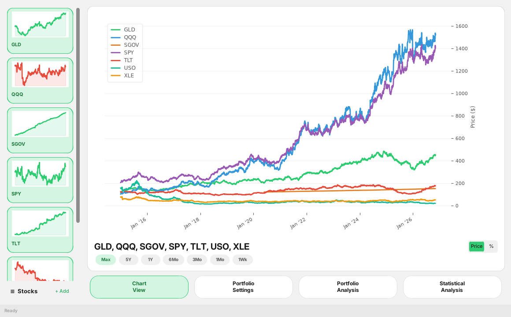
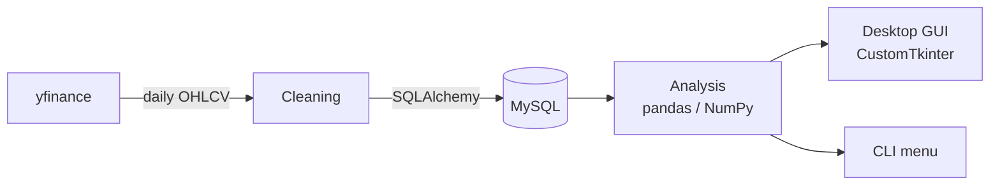
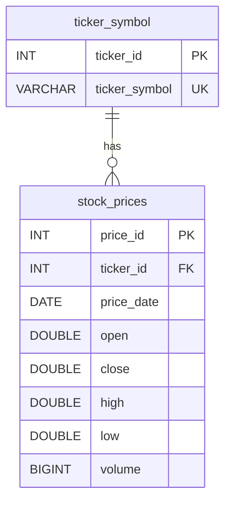
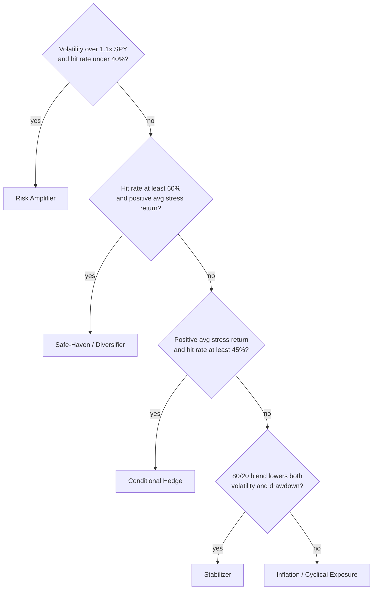

# Defensive Assets

A Python desktop app that pulls daily ETF prices into MySQL and tests which assets actually held up on the S&P 500's worst days. Final project for IS 445 (Database Management).




## Overview

Diversifying only helps if your other holdings don't drop on the same days stocks do. This project measures that directly. It finds the worst 5% of trading days for SPY, looks at how each other asset did on those days, and backtests 80/20 portfolios that pair SPY with each one. Based on the results, each asset is labeled as a safe haven, conditional hedge, stabilizer, risk amplifier, or cyclical exposure.

Default tickers:

| Ticker | Asset |
|---|---|
| SPY | S&P 500 (benchmark) |
| QQQ | Nasdaq-100 |
| TLT | 20+ year Treasuries |
| SGOV | 0–3 month T-bills |
| GLD | Gold |
| USO | Crude oil |
| XLE | Energy sector |

Any other Yahoo Finance ticker can be added from the app.

## Architecture



`dataextraction.py` handles downloading, cleaning, all database access, and every calculation. Its functions return DataFrames and never prompt for input, so `gui.py` and the command-line menu both call the same code.

## Database



- A unique key on `(ticker_id, price_date)` keeps duplicate rows out, and it also serves as the index for date-range queries.
- The foreign key uses `ON DELETE CASCADE`, so removing a ticker also removes its price history.
- Loads are incremental. The pipeline checks which dates are already stored and inserts only the new ones.

## Analysis

| Step | Output |
|---|---|
| Performance | Cumulative return, annualized volatility, max drawdown, Sharpe ratio (5% risk-free rate) |
| Correlation | Each asset's daily-return correlation with SPY, plus the full correlation and covariance matrices |
| Stress-day test | On SPY's worst 5% of days: each asset's average return, how often it was up (hit rate), and how often it was down (co-crash rate) |
| 80/20 backtest | 100% SPY compared with 80% SPY + 20% of each other asset, on return, volatility, and drawdown. The weights can be changed in the app. |

The classification step combines these results using the following rules, checked in order:



## The App

The GUI has four tabs:

- **Chart View:** price or percent-return chart for the selected tickers, with timeframes from 1 week to max. The sidebar shows a sparkline for each ticker.
- **Portfolio Settings:** date range, SPY weight slider, starting investment, ticker selection, and buttons to download data or reset the database.
- **Portfolio Analysis:** performance table, backtest charts, the ending value of the investment for each blend, and the role labels.
- **Statistical Analysis:** correlation heatmap, covariance table, correlation with SPY, and stress-day results.

Downloads and analysis run on background threads, so the window doesn't freeze while they work.

<!-- Screenshots:
| Chart View | Portfolio Analysis | Statistical Analysis |
|---|---|---|
|  |  |  |
-->

## Setup

Install the dependencies:

```bash
pip install sqlalchemy pymysql pandas numpy yfinance python-dotenv customtkinter matplotlib seaborn
```

Create the database and tables:

```bash
mysql -u <user> -p -e "CREATE DATABASE defensive_assets;"
mysql -u <user> -p defensive_assets < DB/schema.sql
```

Copy `.env.example` to `.env` and fill in your MySQL credentials. Then run either one:

```bash
python gui.py              # desktop app
python dataextraction.py   # terminal menu
```

In the app, go to Portfolio Settings, choose a date range, and download the tickers. Every other tab reads from the database once the data is in.

## Files

```
DB/schema.sql        table definitions
dataextraction.py    ETL, analysis functions, CLI
gui.py               desktop app
.env.example         credentials template
```
